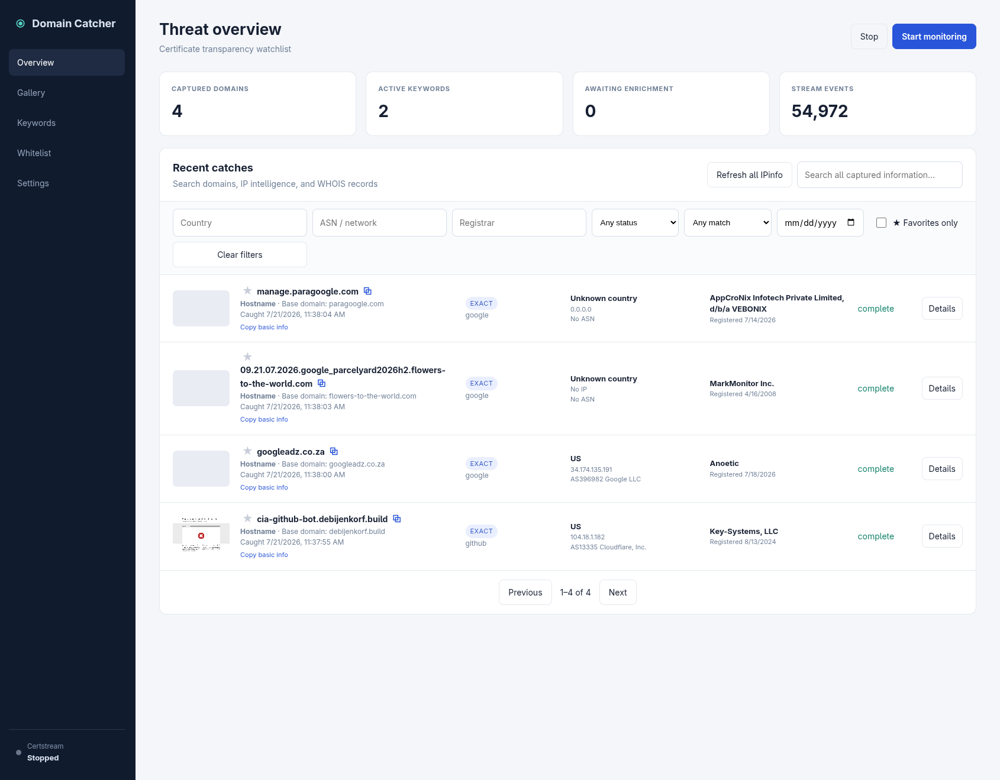
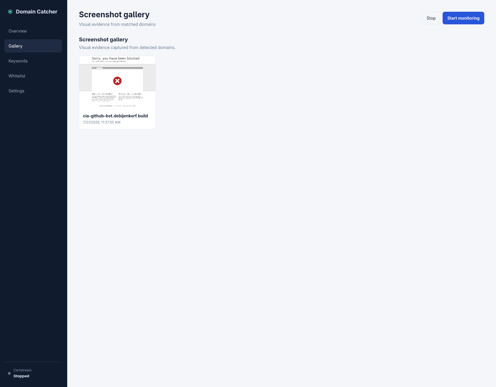

# Domain Catcher

Domain Catcher monitors Certificate Transparency logs for hostnames containing watched keywords. It detects direct and Unicode homoglyph matches, enriches captures with native WHOIS and IPinfo data, takes website screenshots, and stores everything locally.



## Features

- Persistent CertStream background monitor
- Exact and homoglyph keyword detection
- Per-entry matching across all hostname labels, only the base domain, or one exact domain and its subdomains
- Bulk keyword and domain-whitelist management
- Native local `whois` lookups against the registrable domain
- DNS and IPinfo country/ASN enrichment
- Local Chromium screenshots with optional proxy support
- Searchable and filterable live overview
- Favorites, screenshot gallery, JSON/CSV export, and JSON import
- SQLite database and Docker-managed persistent volumes

## Keyword matching modes

Each watched entry has its own matching mode:

- **Catch all** treats the value as a keyword and matches it anywhere in the hostname.
- **Base domain only** searches for the keyword only within the registrable base domain, ignoring subdomain labels.
- **Exact domain match** treats the value as a complete domain and captures only that domain and its subdomains.

For example, an exact-domain entry of `google.com` captures `google.com`, `mail.google.com`, and `accounts.login.google.com`. It does not capture `mygoogle.com`, `google.com.evil.test`, or `google-example.com`.

## Screenshot gallery

Successful website captures are saved locally and displayed in the gallery. Selecting a gallery item opens the same detailed domain view available from the overview.



## Run with Docker

Docker Compose is the recommended setup:

```bash
docker compose up -d --build
```

Open <http://localhost:3000>, configure an IPinfo token if desired, add keywords, and press **Start monitoring**.

Useful commands:

```bash
docker compose logs -f
docker compose restart domain-catcher
docker compose down
```

`docker compose down` preserves the named volumes. Do not add `-v` unless you intend to delete the database, screenshots, and CertStream cursor state.

## Run without Docker

Requirements: Node.js 22+, Chromium/Google Chrome, and the `whois` command.

```bash
npm install
npm start
```

Open <http://localhost:3000>. The default data paths are `data/` and `screenshots/`.

## Persistence and restart behavior

The monitoring enabled state is stored in SQLite. If the service or host restarts while monitoring is enabled, Domain Catcher reconnects to CertStream automatically. Queued enrichment work is durable, and any item interrupted in the `processing` state is moved back to `queued` during startup. Docker Compose uses `restart: unless-stopped` for both services.

Docker volumes:

- `domain-catcher-data`: SQLite database
- `domain-catcher-screenshots`: captured images
- `certstream-state`: Certificate Transparency cursor state

## API

- `GET /get-all`: every captured record with complete stored WHOIS and IPinfo data
- `GET /api/catches`: paginated, searchable results
- `GET /api/status`: monitor state and counts

This application has no authentication. Keep it on a trusted network or place it behind an authenticated reverse proxy.
